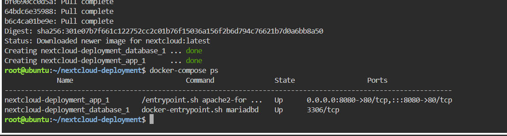
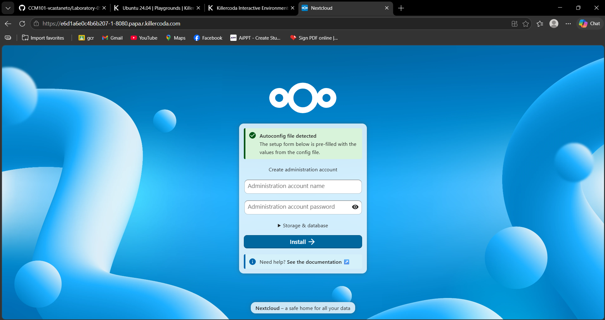
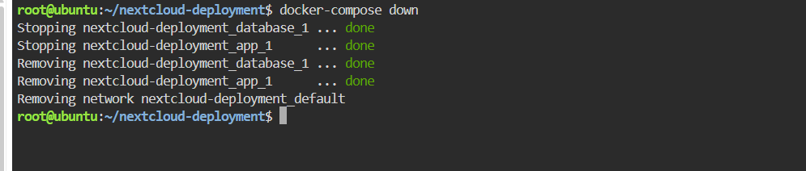

# ☁️ Laboratory 06 – Cloud Deployment Engineer

## 📑 Table of Contents

1. [Mission Overview](#1-mission-overview)
2. [Objectives](#2-objectives)
3. [Commands Executed](#3-commands-executed)
4. [Skills Learned](#4-skills-learned)
5. [Evidence](#5-evidence)
6. [Repository Contents](#6-repository-contents)
7. [References](#7-references)

---

## 1. Mission Overview

This laboratory explores multi-tier application deployment using Docker Compose. The project defines a Nextcloud application container and a MariaDB database container to demonstrate how related services can work together as a private cloud storage solution.

---

## 2. Objectives

- Explain the roles of the application and database tiers.
- Create a Docker Compose YAML configuration.
- Deploy and inspect multiple containers.
- Access the Nextcloud setup page through a browser.
- Document Infrastructure as Code principles.
- Maintain a structured GitHub Cloud Computing portfolio.

---

## 3. Commands Executed

```bash
mkdir nextcloud-deployment
cd nextcloud-deployment
nano docker-compose.yml
docker-compose up -d
docker-compose ps
docker-compose down
```

---

## 4. Skills Learned

- Writing and editing YAML configuration files.
- Deploying multi-container applications with Docker Compose.
- Understanding container networking and environment variables.
- Verifying container status and troubleshooting startup problems.
- Documenting deployment procedures using Markdown.
- Organizing project files and screenshots in GitHub.

---

## 5. Evidence

The `screenshots/` directory contains evidence captured during deployment, application access, and teardown.

| Screenshot | Shows |
|------------|-------|
| `screenshots/compose-deployment.png` | Successful deployment and running containers |
| `screenshots/nextcloud-web.png` | Nextcloud installation page in the browser |
| `screenshots/compose-teardown.png` | Containers being stopped and removed |

### Deployment



### Nextcloud Setup Page



### Teardown



---

## 6. Repository Contents

```text
Laboratory-06-Cloud-Deployment-Engineer
├── README.md
├── multi-tier-architecture.md
├── docker-compose-guide.md
├── reflection.md
└── screenshots/
    ├── compose-deployment.png
    ├── nextcloud-web.png
    └── compose-teardown.png
```

---

## 7. References

- <https://docs.docker.com/compose/>
- <https://docs.nextcloud.com/>
- <https://mariadb.com/docs/>