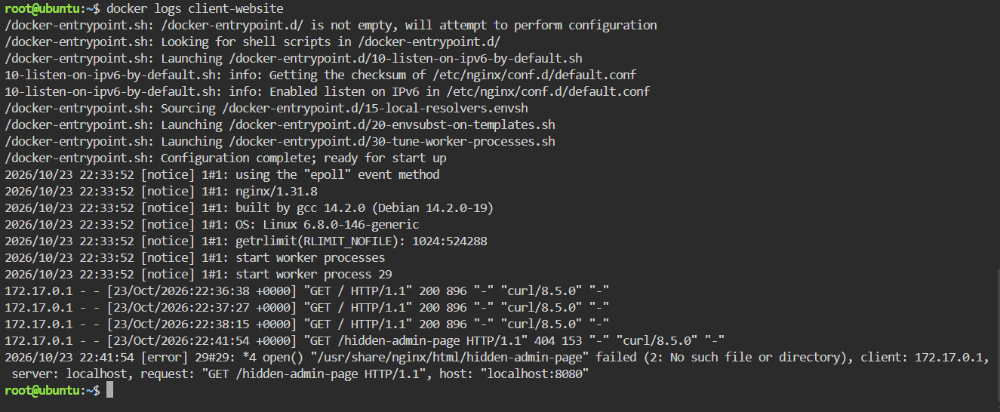

# 🔍 Container Observability Report

## 📑 Table of Contents

- [Application Logs](#application-logs)
- [Container Metrics](#container-metrics)

---

## Application Logs

The `docker logs client-website` command was used to retrieve the logs generated by the Nginx web server container.

### HTTP 404 Error Evidence

```text
172.17.0.1 - - [23/Oct/2026:22:41:54 +0000] "GET /hidden-admin-page HTTP/1.1" 404 153 "-" "curl/8.5.0" "-"
```

### Importance of Application Logs

Application logs are important because they record requests and errors that help engineers understand what happened when a problem occurred. By examining request paths, timestamps, and HTTP status codes, engineers can identify failed requests and investigate possible causes of application issues.

**Analysis:** The logs show three successful requests with HTTP status code 200 and one failed request with HTTP status code 404. The error log confirms that Nginx could not find the requested `hidden-admin-page` file in its document directory.

**Screenshot Evidence:** `screenshots/docker-logs.png`



---

## Container Metrics

The `docker stats` command was used to view the resource consumption of the `client-website` container.

| Metric | Value |
|--------|-------|
| Container ID | `4bb53d5b96ae` |
| Memory Usage | 2.73MiB / 1.859GiB |
| CPU Percentage | 0.00% |
| Memory Percentage | 0.14% |
| Network I/O | 3.69kB / 5.21kB |
| Block I/O | 0B / 12.3kB |
| PIDs | 2 |

### Analysis

The Nginx container consumed 2.73 MiB of memory, representing 0.14% of its memory limit, while CPU usage was 0.00% at the time of measurement. These results indicate low resource consumption during the observation, but further testing under heavier traffic would be necessary to evaluate performance during a large traffic surge.

**Screenshot Evidence:** `screenshots/container-metrics.png`

