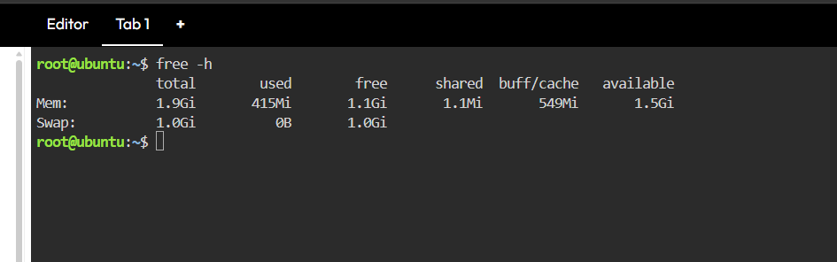
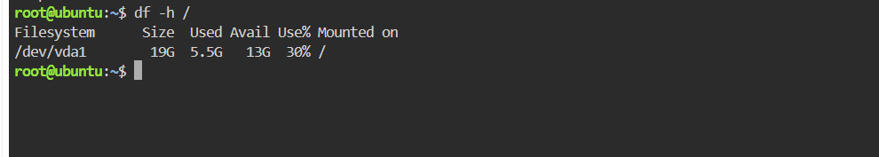

# 🖥️ System Baseline Report

## 📑 Table of Contents

- [Overview](#overview)
- [Memory Baseline](#memory-baseline)
- [Disk Baseline](#disk-baseline)
- [CPU and Process Monitoring](#cpu-and-process-monitoring)
- [Conclusion](#conclusion)

---

## Overview

This report documents the initial health check of the Ubuntu server using the KillerCoda Playground. The purpose is to assess memory, disk storage, and CPU activity before deploying a containerized web application.

---

## Memory Baseline

The `free -h` command was used to check the server's memory usage.

| Metric | Value |
|--------|-------|
| Total RAM | 1.9 GiB |
| Used Memory | 420 MiB |
| Free Memory | 1.2 GiB |
| Available Memory | 1.4 GiB |
| Total Swap | 1.0 GiB |
| Used Swap | 0 B |

The server has approximately 1.4 GiB of available memory, which can be used by applications and system processes.

**Screenshot Evidence:** `screenshots/memory-check.png`

---

## Disk Baseline

The `df -h /` command was used to check the root filesystem's storage capacity.

| Metric | Value |
|--------|-------|
| Filesystem | `/dev/vda1` |
| Total Storage Capacity | 19 GB |
| Used Storage | 5.5 GB |
| Available Storage | 13 GB |
| Disk Usage | 30% |

Checking disk space before a massive traffic surge is important because insufficient storage can prevent applications from writing logs and temporary files, potentially causing errors or service interruptions.

**Screenshot Evidence:** `screenshots/disk-check.png`

---

## CPU and Process Monitoring

The `top` command was used to observe CPU activity and active processes.

| Metric | Value |
|--------|-------|
| Total Tasks | 130 |
| Running Tasks | 1 |
| Sleeping Tasks | 129 |
| Stopped Tasks | 0 |
| Zombie Tasks | 0 |
| CPU Idle | 100% |
| Memory Used | 420.6 MiB |
| Available Memory | 1482.6 MiB |
| Swap Used | 0 MiB |

The CPU was 100% idle during the observed snapshot, indicating that it was not performing measurable CPU work at that moment. This suggests a light workload during the baseline check, but it does not prove that the server can handle thousands of simultaneous users.

---

## Conclusion

The initial baseline shows that the server has 1.9 GiB of RAM, 19 GB of root filesystem storage, and 13 GB of available disk space. These measurements provide a starting point for monitoring the server's health before and during the Nginx deployment.